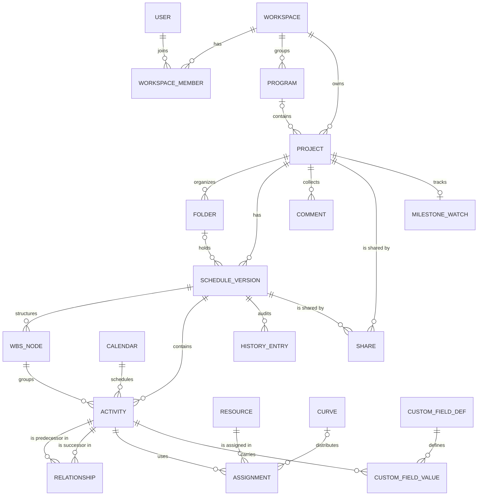
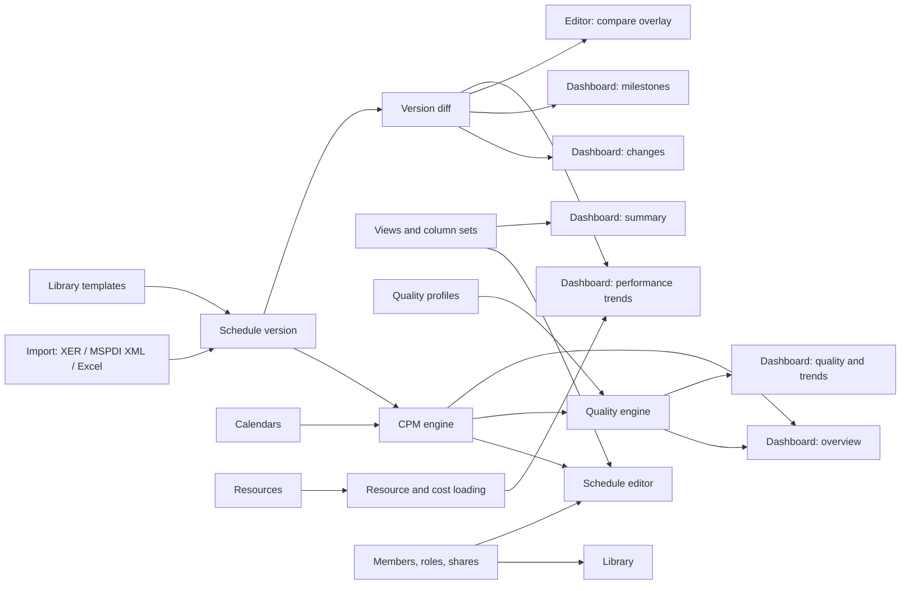

# Product Map — Full Application Structure

| | |
|---|---|
| **Date** | 2026-10-14 |
| **Status** | Reference for all phases. Phase 1 builds only the shell and Home (see `docs/superpowers/specs/2026-10-14-home-shell-design.md`). |
| **Basis** | Read-only functional analysis of a reference construction-scheduling product's running UI (screens, menus, panels, flows, URL structure). No source code was read or copied. All naming, wording, scoring and visual identity in this product are our own. |
| **Use** | Each roadmap phase (`docs/product/roadmap.md`) turns a slice of this map into its own spec and plan: superpowers brainstorming → writing-plans → execution. |

---

## 1. Navigation model

Three nested contexts drive every screen: **Workspace ⊃ Project ⊃ Schedule version**.

```
Top bar  [≡] [Logo] [Workspace ▾] [Project ▾] [Version ▾ + calc status]*  ………  [Share]* [Plan badge] [Account ▾]
Sidebar  Home · Library · Assets | WORKSPACE: Projects | PROJECT: Files · Dashboard · Schedule
         (* only on schedule-editor pages)
```

| Route (ours) | Screen | Context it needs | Phase |
|---|---|---|---|
| `/sign-in` | Sign in | — | 1 (mock), 2 (real) |
| `/home` | Home | user | 1 |
| `/library` | Schedule library: every version the user can access, across workspaces | user | 3 |
| `/assets/:tab?` | Reusable assets: views, columns, calendars, layouts, resources, curves, palettes, reports, quality profiles | user (+ scope filters) | 5 |
| `/w/:workspaceId/projects` | Projects: tile / list / map | workspace | 3 |
| `/w/:workspaceId/p/:projectId/files` | Project files (schedule versions) | project | 3 |
| `/w/:workspaceId/p/:projectId/dashboard/:tab?` | Project dashboard: overview, summary, milestones, quality, performance, changes | project + current version | 6 |
| `/w/:workspaceId/p/:projectId/schedule?scheduleId=` | Schedule editor (grid + Gantt) | project + version | 4 |
| `/settings/profile`, `/settings/billing`, `/w/:workspaceId/settings` | Account and workspace settings | user / workspace | 7 |

Phase 1 already ships these paths as placeholders, so later phases only replace page content.

---

## 2. Domain model

### 2.1 Entities

| Entity | Key fields | Notes | Phase |
|---|---|---|---|
| User | id, first/last name, email, avatar, locale, time zone | | 1–2 |
| Workspace | id, name, kind (personal / team) | one personal workspace per user | 1–2 |
| WorkspaceMember | workspace, user, role (owner / editor / viewer) | drives access everywhere | 2 |
| Program | workspace, name | optional grouping of projects | 3 |
| Project | code (unique per workspace), name, photo, description, status (active / on hold / completed / cancelled), stage (pursuit / preconstruction / construction / closeout / completed), project type, sector, client, location (address, city, country, lat/lng), planned start / finish, current-version pointer | Phase 1 has a subset | 1–3 |
| Folder | project, parent, name | tree inside project files | 3 |
| ScheduleVersion ("schedule file") | project, folder, code, name, status date (data date), tag (current / baseline / update n), lock (user, time), notes, archived, calculation mode, source (blank / template / import + file name), activity count, created / modified | exactly one current per project | 3 |
| WbsNode | version, parent, code, name, order | tree; rollups computed | 4 |
| Activity | version, WBS node, code, name, type, calendar, original / remaining / actual duration, start / finish (early, late, actual), primary + secondary constraint (type, date), physical % and duration %, status, notes | computed: total float, free float, critical, driving | 4 |
| Relationship | version, predecessor, successor, type (FS / SS / FF / SF), lag (negative = lead), lag calendar | computed: driving | 4 |
| Calendar | scope, name, work week (days, hours), exceptions (holidays, extra working days) | feeds every date calculation | 4 |
| Resource | scope, category (cost / people / labor / material), unit, rate | | 5 |
| Assignment | activity, resource, budgeted / actual / remaining quantity and cost, curve | | 5 |
| Curve | scope, name, distribution profile | spreads quantities over time | 5 |
| CustomFieldDef / Value | scope, name, data type (text / number / date / list); value per activity | | 5 |
| View | scope, columns, filters, grouping, sorting, timescale, bar styles | saved per user / workspace / project | 5 |
| ColumnSet, Layout, Palette, ReportTemplate | scope + configuration | presentation assets | 5–7 |
| QualityProfile | scope, checks (enabled, threshold, weight) | defaults ship built-in | 6 |
| MilestoneWatch | project, tracked activity codes | compared across versions | 6 |
| Comment | project, activity code, author, body, mentions, resolved | keyed by activity code so it survives new versions | 7 |
| HistoryEntry | version, user, time, change set | audit trail of edits | 7 |
| Share | target (project or version), principal (user or link), access level (editor / viewer / restricted) | | 7 |
| Subscription, Task (to-do) | as in the Phase 1 spec | | 1–2 |

### 2.2 Relationships



### 2.3 Rules that tie the model together

- **Asset scope resolution:** project → workspace → user → built-in default; the most specific wins.
- **Versions are snapshots.** A new status update copies the current version, moves the status date and records progress. Comparisons, comments and milestone tracking match activities across versions **by activity code**.
- **One current version per project;** any number may be flagged baseline, and one of them is the *primary* baseline used for variance. Updates are numbered by status date.
- **Editing takes a lock** on the version (shown in the files list); it is released on save, on leaving the editor, or after an idle timeout. Viewers never lock.
- **Archived** versions and folders are hidden unless "show archived" is on.
- **Access:** owner > editor > viewer > restricted; a version share can only grant read access unless the person is a project member.

---

## 3. Scheduling engine — the dependency logic

### 3.1 Inputs

- Activities: type, durations, calendar, constraints, progress (actual start / finish, remaining duration, % complete).
- Relationships: FS, SS, FF, SF, each with a lag in working time (negative lag = lead); the lag uses the successor's calendar unless the version says otherwise.
- Version settings: status date, calculation mode, critical-path definition, near-critical threshold.

### 3.2 Activity types and constraints

| Activity types | Constraints |
|---|---|
| Task (duration from its calendar), start milestone, finish milestone, level of effort (spans its predecessors / successors), WBS summary (rollup only) | Start on · Start on or after · Start on or before · Finish on · Finish on or after · Finish on or before · Mandatory start · Mandatory finish · As late as possible — "mandatory" ones are *hard* constraints, the rest *soft* |

### 3.3 Calculation

1. **Validate:** no self-links, no duplicate links, no links across versions, **no cycles** (topological sort; when a loop exists, report the full loop path and refuse to schedule).
2. **Forward pass** in topological order → early start / finish, honoring relationship type + lag, calendars and constraints. Unstarted work can't start before the status date; the remaining part of in-progress work starts at the status date.
3. **Backward pass** from the project finish (or a "must finish by" date) → late start / finish.
4. **Float:** total float = late finish − early finish in working time of the activity's calendar; free float = the smallest gap to any successor's early date given the link type and lag.
5. **Critical:** total float ≤ threshold (default 0), or "longest path" when the version is set to it. **Near-critical:** total float ≤ N working days (default 10).
6. **Driving links:** a predecessor link is driving when it determines the successor's early date (zero gap). **Driving path** to a selected activity = walk back along driving links.
7. **Progress modes:** *retained logic* (remaining work still waits for unfinished predecessors), *progress override* (in-progress activities ignore their logic), *as imported* (keep imported dates, recalculate floats only).
8. **Rollups:** WBS start = earliest child start, finish = latest child finish, % complete weighted by duration (or by budget once resource-loaded).
9. **Performance budget:** 10 000 activities and 15 000 links recalculated in under 300 ms in a Web Worker.

### 3.4 Version comparison

Activities are matched by code. A diff reports added / removed activities, duration changes, start / finish variance, logic changes (links added, removed, retyped, lag changed), constraint changes and progress changes. It feeds the dashboard's changes and milestones tabs, the editor's compare overlay, variance views and performance trends.

### 3.5 Schedule quality checks

Built on the public DCMA 14-point assessment plus common practice; thresholds default to the DCMA guidance, while **weights, scores and labels are our own design** and every value is editable in a quality profile.

| # | Check | Default threshold |
|---|---|---|
| 1 | Open ends: activities without a predecessor or without a successor (excluding the start / finish milestone) | ≤ 5 % |
| 2 | Leads (negative lags) | 0 % |
| 3 | Lags | ≤ 5 % of links |
| 4 | Relationship types: FS share; any SF link | FS ≥ 90 %, SF = 0 |
| 5 | Hard constraints | ≤ 5 % |
| 6 | High total float (> 44 working days) | ≤ 5 % |
| 7 | Negative float | 0 % |
| 8 | High duration (> 44 working days, tasks only) | ≤ 5 % |
| 9 | Invalid dates: actuals after the status date, forecasts before it | 0 % |
| 10 | Missing resources (when the version is resource-loaded) | ≤ 5 % |
| 11 | Missed activities (baseline finish before the status date, not finished) | ≤ 5 % |
| 12 | Critical path test: delaying the critical path moves the project finish | pass |
| 13 | Critical path length index (CPLI) | ≥ 0.95 |
| 14 | Baseline execution index (BEI) | ≥ 0.95 |
| + | Out-of-sequence progress, activities riding the status date, soft-constraint share, excessive SS/FF lags, lag longer than the activity, one-day activities, merge / burst hotspots (many predecessors or successors) | profile-defined |

Every check lists the affected activities and links so the editor can filter to them.

---

## 4. How the modules depend on each other



**Build order this implies:** data model → import → CPM engine → editor → diff and quality → dashboard → assets and collaboration. The roadmap phases follow it.

---

## 5. Screen inventory

**Home** (Phase 1) — as specified in the Phase 1 spec.

**Library** (Phase 3) — tree of workspace → project → version; columns: name, code, tag, status, status date, created; filters: workspace, project, tag, status, access level, hide empty; open, share and bulk select.

**Assets** (Phase 5) — nine tabs (views, columns, calendars, layouts, resources, curves, palettes, reports, quality profiles); each lists name, scope and usage; create, edit, duplicate, delete; scope filters (user / workspace / project).

**Projects** (Phase 3) — workspace header with settings, "add program", "add project"; counters (projects, versions); search; filters (status, status-date range, stage, project type, sector, client, city); sort (recently opened, name, status date); tile / list / map layouts; sections for recently opened, all projects, programs; an entry point to schedules shared with me.

**Project files** (Phase 3) — header with photo, name, settings, "compare two versions", import, "create schedule"; counters (status date, versions, current version) and "open current"; search; filters (tag, has notes, folder, hide empty); folders; show archived; table: current, name, lock, code, status date, baseline flag, update number, last modified, activity count, notes; bulk archive / move / delete.

**Dashboard** (Phase 6) — header KPIs (status date, time remaining, activity count) and export; tabs:
- *Overview:* criticality profile, completion, quality score, milestone tracker.
- *Summary:* WBS-level Gantt against the previous update or baseline, with a focus window.
- *Milestones:* chosen milestones' forecasts against the previous update and baseline.
- *Quality:* score, trend across tagged versions, check list with drill-down to the affected activities.
- *Performance:* trends across tagged versions — progress curve, float erosion, schedule compression, BEI / CPLI.
- *Changes:* diff between two versions; timeline of all updates.

**Schedule editor** (Phases 4–7)
- *Top bar additions:* version switcher (folders, search, calculation status) and share.
- *Toolbar:* view / edit toggle; command palette (Ctrl+K) for commands and columns; file menu (new, import, open, save as, print, batch print, export PDF / Excel / Excel with comments / XER); details panel; views; filter (quick and advanced, match all / any; by status, dates, name, code, resources, float, custom fields, constraints, duration, type, calendar, WBS, comments, selection); group (WBS and codes); sort; link lines; critical path; driving path; focus window; compare; quality overlay; resources; comments; history; task search.
- *Grid:* row number, code, name, duration, start, finish, predecessors, assigned people, % complete, resource spread; WBS rows with rollups; expand / collapse.
- *Timeline:* automatic timescale, zoom, zoom to fit, today and status-date lines, bars for tasks, milestones, summaries, baseline ghosts and links.
- *Details panel tabs:* details (status and progress, durations, float and info, constraints) · relationships (predecessors and successors with type, driving flag, lag, name) · resources (by category: projected, actual, total, rate, spread) · custom fields.
- *Side panel:* comments per activity.
- *Status bar:* version code, status date, calculation mode, active view (with a modified marker), filtered / total activity count, zoom.

**Settings** (Phase 7) — profile, billing, workspace members and roles, project settings.

---

## 6. Phase 1 coverage

| Module | Phase 1 state |
|---|---|
| Shell (top bar, sidebar, switchers, user menu, plan badge) | Built (schedule switcher and share come in Phase 4 / 7) |
| Home | Built |
| Projects, Files, Dashboard, Schedule, Library, Assets, Settings | Placeholder pages on their final routes |
| Data layer | Mock repository with the Phase 1 entities; interfaces ready for Supabase |
| Project wizard | Built (details, attributes, client, location); stage, sector and type options extend in Phase 3 |
| Schedule data (WBS, activities, links, calendars) | Not started — Phase 4 |
